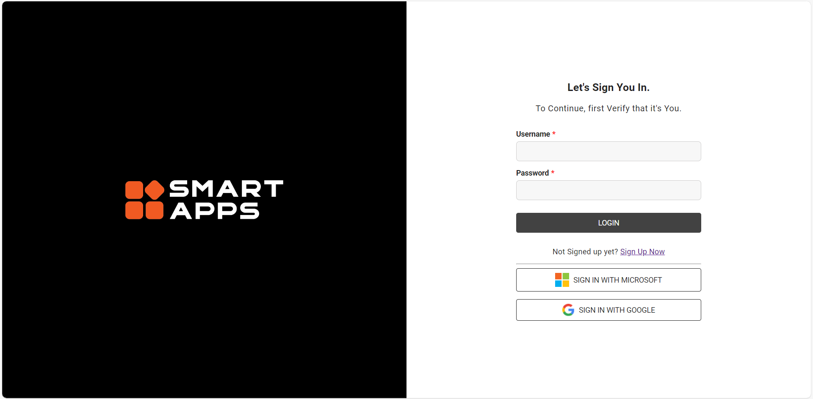
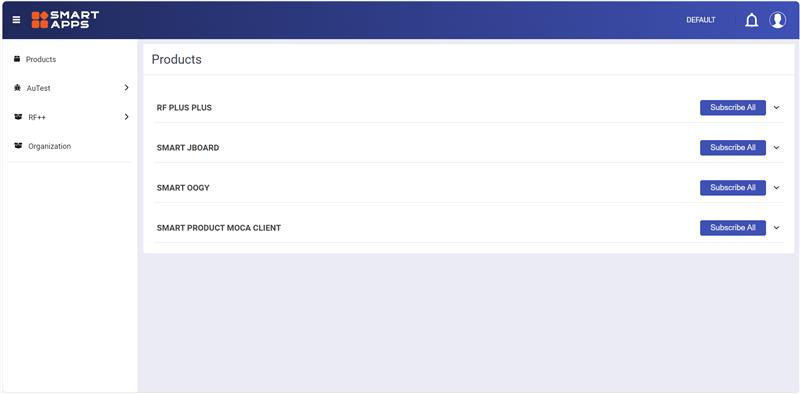
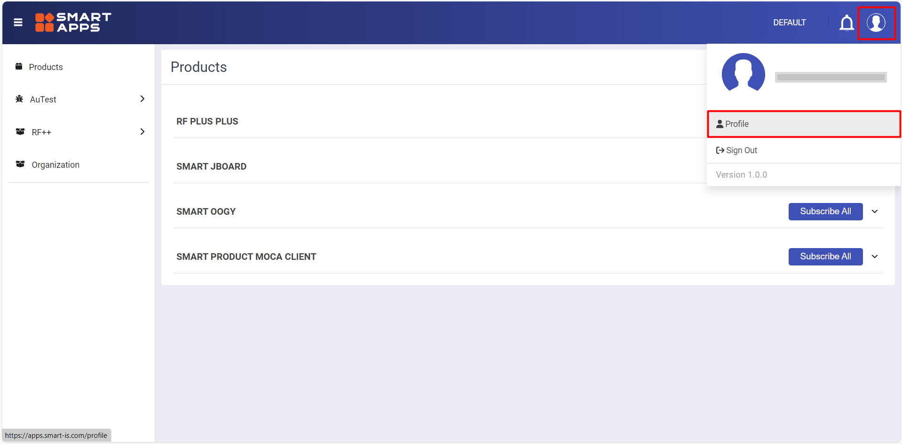
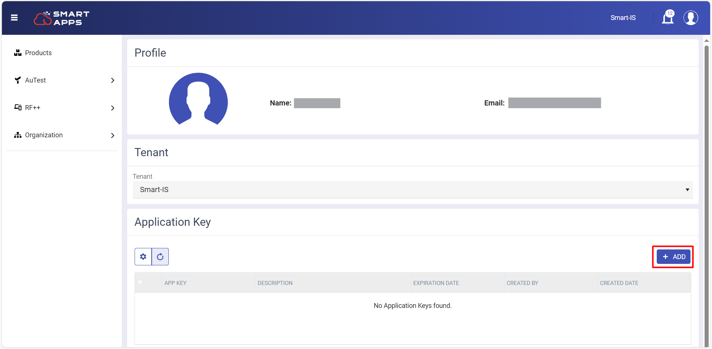
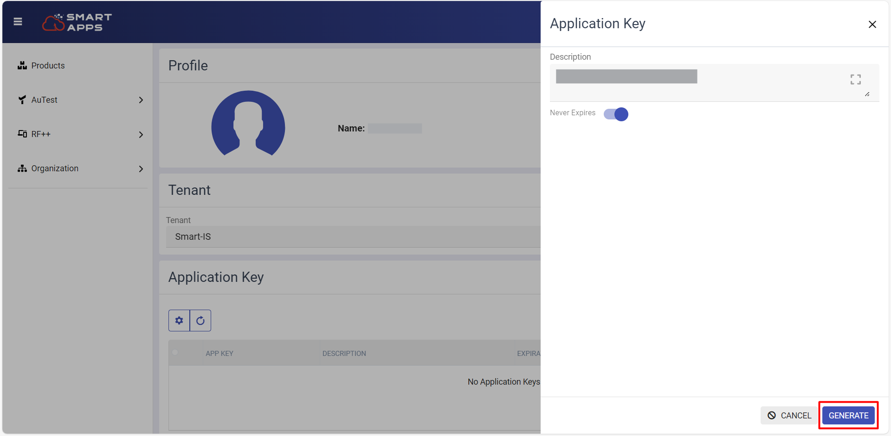
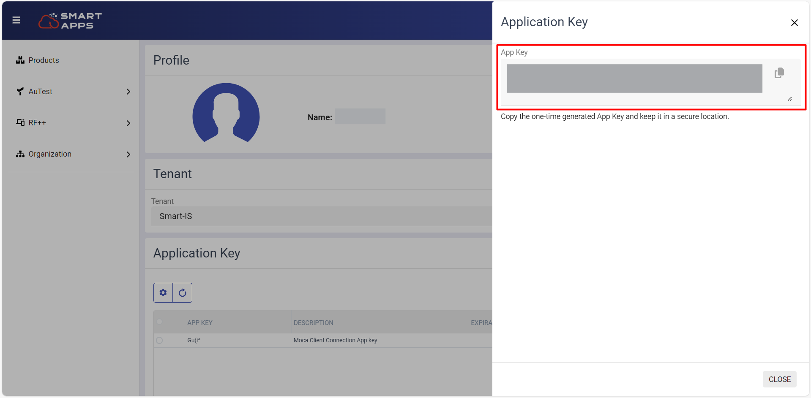

# Register on SmartApps
 
- Visit [Smart Apps Portal](https://apps.smart-is.com/).
- Now "Sign Up, if you don't have an account or log in with Microsoft or Google".
 

     
     

## Generating Your App Key

- Now enter your login credentials to access your smart app account.
 

     
     

- Once logged in, navigate to your profile page. This is usually found in the user menu, accessible by clicking on your username or profile icon.

     
     

- Click on "Add" button to generate key.
 

     
     

- Now give description to your app key and click on "Generate" button.
 
 

     
     

- This action will generate a new one-time generated app key containing all your license information. Once the app key is generated, copy it to your clipboard.
 
 

     
     
